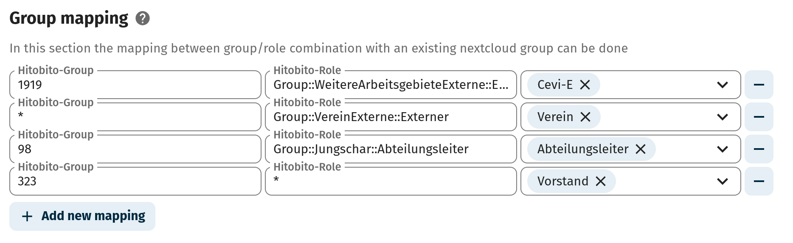
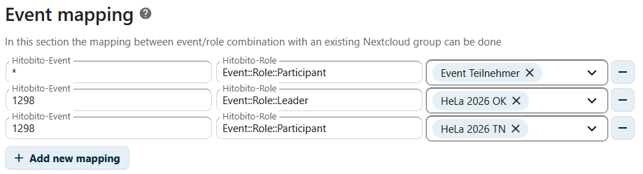

# Hitobito-Login

`Hitobito-Login` is an extension app for nextcloud enabling login functionality using an instance of [hitobito](https://github.com/hitobito/hitobito) (open source organisation/community management tool) as authentication backend. It also implements group and role mapping between the two systems.

This application and its developers are not affiliated with, endorsed by, or associated with Puzzle ITC (the developers of hitobito). All trademarks and copyrights belong to their respective owners.

## Installation
First the app needs to be installed on the Nextcloud instance:
1. Find the app in the app store
    - Go to `https://<your-nextcloud-instance-url>/settings/apps/security/hitobitologin`
        - Replace `<your-nextcloud-instance-url>` with your respective url (if [Pretty URLs/URL rewrite](https://docs.nextcloud.com/server/latest/admin_manual/installation/source_installation.html#pretty-urls) is not enabled it's `<your-nextcloud-instance-url>/index.php` ) 
    - Alternatively login to your nextcloud instance and search `hitobitologin` in the app view.
2. Click on `Download and Enable`

Congratulations, the app is now installed on your Nextcloud instance.

## Configuration
The app can be configured over the configuration interface. The interface can be opened as follows:
- Go to `https://<your-nextcloud-instance-url>/settings/admin/hitobitologin`
        - Replace `<your-nextcloud-instance-url>` with your respective url
- Alternatively login to your nextcloud instance and go to `Administration Settings`. Afterwards search `Hitobito Login` in the overview on the left side.

### Hitobito OAuth-Token
Before being able to configure and use this app a OAuth token for it has to be generated on the hitobito instance to be used. The token needs at least the `with_roles` scope in order to work correctly. A new OAuth token can be generated in hitobito under `Settings->OAuth Applications`. If you cannot see this menu point you most probably do not have enough rights to generate such a token. Please then inform an administrator of your hitobito instance of your need for such a token. You will need to provide a `redirect-url` to generate such a token. The `redirect-url` should be defined as follows: `https://<your-nextcloud-instance-url>/apps/hitobitologin/login/oauth`

### General Settings
The general settings section of the configuration consists of the following fields:
- Checkbox: `Remove groups assigned by this app when the mapping no longer applies`
    - If this checkbox is set, a user loses the Nextcloud groups that were assigned to them by this app as soon as no group or event mapping assigns them anymore (checked upon login). Groups the user got by other means (assigned by an administrator, LDAP, other apps) are never removed. See [Group handling](#group-handling) for details.
- Checkbox: `Block users without a mapped group/role match`
    - If this checkbox is set users which do not have a group associated by a group mapping will not be able to login.
- Checkbox: `Search for existing users by email`
    - Setting this checkbox will allow the app to try to map existing users to hitobito users by e-mail. **!!Beware that if multiple users with the same e-mail-address exist on the Nextcloud instance they will be prohibited from logging in with hitobito!!**
- Checkbox: `Enable event mapping`
    - Setting this checkbox will enable the event mapping. **!!Beware that you need to enable the additional OAuth scope `event_participations` in hitobito to use this feature!!**
- Checkbox: `Use hitobito as default login`
    - Setting this checkbox will activate an automatic redirect to hitobito skipping the Nextcloud login page. To login with a local user the following URL must be used: `https://<your-nextcloud-instance-url>/login?direct=1` 
- Input-Field: `Base-URL`
    - This field needs to be filled with the base url of the hitobito instance to be used for authentication. `https://demo.hitobito.com` for example.
- Input-Field: `Client-ID`
    - This field has to be populated with the client-id of the hitobito oauth-token. See [Hitobito OAuth-Token](#hitobito-oauth-token) for explanation how to create the token.
- Input-Field: `Client-Secret`
    - This field needs to be populated with the client-secret of the same hitobito oauth-token as is used with the id.
- Input-Field: `Login-Button Text`
    - Here the text of the login button on the nextcloud login page can be adjusted.

### Group mapping
Group mappings enable automatic group assignment to users logging in via the hitobito login functionality. This allows for close permission integration between the two applications. Mappings can be added by using the `Add new mapping` button on the bottom left of the page.

Each mapping contains the following three fields:
- Input-Field: `Hitobito-Group`
    - This field needs to be populated by the group-id of the group to be matched. The group-id can be found by navigating to the group on hitobito and looking at the URL `https://<base-url>/groups/<group-id>`. Instead of a group id `*` can be used so that any group matches with this mapping. This is usefull if only the role is relevant for the mapping. 
- Input-Field: `Hitobito-Role`
    - This field needs to be populated by the role-type/class of the role to be matched. The type names can be retrieved by using the `/api/roles/` endpoint. This field supports the use of one `*` which means that the following values are equally possible:
        - `*`
        - `Group::Dachverband::Administrator`
        - `Group::Dachverband::*`
        - `Group::*::Administrator`
        - `*::Dachverband::Administrator`
- Multi-Field: `Mapped-Groups`
    - This field contains the nextcloud groups that are going to get assigned to a user upon login if the mapping matches the user.

**Example:**

### Event mapping
Event mappings provide the same functionality as group mappings but are based on hitobito events instead of groups.

**This is an optional feature and when enabled requires the additional OAuth scope `event_participations`. If this scope doesn't exist, the Hitobito version is too old and the feature is not available.**

Each mapping contains the following three fields:
- Input-Field: `Hitobito-Event`
    - This field needs to be populated by the event-id of the event to be matched. The event-id can be found by navigating to the event on Hitobito and looking at the URL `https://<base-url>/groups/<group-id>/events/<event-id>`. Instead of an event id `*` can be used so that any event matches with this mapping. This is usefull if only the event role is relevant for the mapping.
- Input-Field: `Hitobito-Event-Role`
    - This field needs to be populated by the role-type/class of the event role to be matched. The type names can be retrieved by going to `https://<base-url>/groups/<group-id>/events/<event-id>/participations.json` while being logged into Hitobito. This field supports the use of one `*` which means that the following values are equally possible:
        - `*`
        - `Event::Role::Participant`
        - `Event::Role::*`
        - `Event::*::Participant`
        - `*::Role::Participant`
- Multi-Field: `Mapped-Groups`
    - This field contains the nextcloud groups that are going to get assigned to a user upon login if the mapping matches the user.

**Example:**

### Group handling
Nextcloud groups used as targets of a mapping have to exist beforehand, this app never creates or deletes groups. It only manages memberships of users in those groups and keeps track of which memberships it assigned itself by registering its own group backend (named `hitobito`) in Nextcloud:
- Upon login, the user is added to all mapped groups they are not yet a member of. These memberships are stored in the app's group backend.
- If the checkbox `Remove groups assigned by this app when the mapping no longer applies` is set, memberships stored in the app's group backend whose mapping no longer applies are removed upon login. Memberships the user has by other means (assigned by an administrator, LDAP, other apps) are never removed, even if the checkbox is set.
- If a user already is a member of a mapped group by other means, the app does not record a membership of its own. Such a membership is therefore not removed when the mapping no longer applies.
- Removing a user from a group manually also removes the membership recorded by the app. It is assigned again upon the next login if the mapping still applies.
- Deleting a group or a user also removes the memberships recorded by the app. `occ maintenance:repair` additionally cleans up memberships of groups which no longer exist.

**Upgrading from version 1.2.x or earlier:** Older versions stored all memberships in the regular Nextcloud group backend, so it is not known which memberships were assigned by the app. Upon upgrade:
- If `Automatically remove groups from user` was enabled, all group memberships of users who logged in through this app (including `admin`) are moved into the app's group backend, since the app would have removed any membership not coming from a mapping upon the next login anyway.
- If it was disabled, existing memberships stay where they are and are never removed by the app. Only memberships assigned after the upgrade are tracked by the app.

## Development Guide
### Documentation for developers:
- General documentation and tutorials: https://nextcloud.com/developer
- Technical documentation: https://docs.nextcloud.com/server/latest/developer_manual

### Help for developers:
- Official community chat: https://cloud.nextcloud.com/call/xs25tz5y
- Official community forum: https://help.nextcloud.com/c/dev/11
